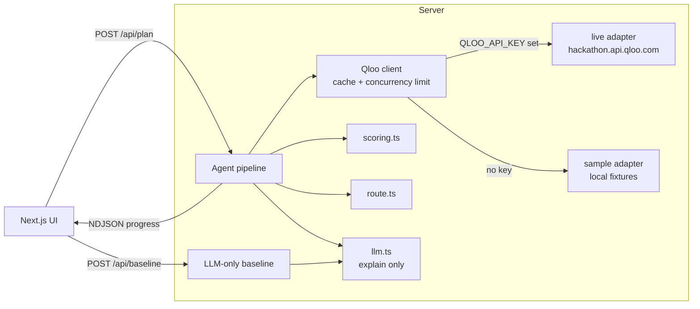

# Tour Router

**An agent that routes a tour for an independent artist to the cities where their audience already lives.**

Type an artist. Tour Router uses Qloo's taste graph to score 40 cities across the US, the UK and Europe, and Africa by how strongly local places match that artist's audience. It routes the best cities into a short path and fills each night with venues, openers and somewhere to go after the show. An LLM then writes a short reason for each stop that cites the Qloo numbers behind it.

Built for the [Qloo Agentic Hackathon](https://qloo.devpost.com/).

> **Live demo:** _add your Vercel URL here_

## Why Qloo is essential

Ask an LLM to plan a tour for an Afrobeats artist and it guesses: London, New York, Lagos, maybe Houston. It can't tell whether this particular artist's audience is in Manchester or Birmingham, or how deep the scene is in Accra compared with Nairobi.

In Tour Router, **Qloo makes every decision that matters**:

| Decision | Who decides |
|---|---|
| Which entity "Tems" refers to (artist, not the album) | Qloo `/search` |
| How well each city matches the artist's audience | Qloo `/v2/insights` (places, artist as signal, city as location) |
| Which cities make the tour, and their rank | Scoring formula over Qloo affinity values |
| Stop order | Shortest-path routing (nearest neighbour + 2-opt) |
| Venues and after-show spots | Qloo place results for that city |
| Openers | Qloo similar-artist results |
| Audience age and gender | Qloo demographics |
| The sentence explaining each stop | LLM, **explain only**: it sees the Qloo numbers and must cite them |

The **With Qloo / Without Qloo** toggle runs the same request through the LLM alone, so you can compare the two plans side by side.

## Architecture



The pipeline (`src/lib/agent.ts`):

1. **Resolve** the artist with `/search`, skip albums, and keep other artist matches so the user can correct the pick.
2. **Score** each candidate city: `GET /v2/insights?filter.type=urn:entity:place&signal.interests.entities=<artist>&filter.location.query=<city>`, then `scoreCity()` turns the returned affinities and popularity into a 0–100 score.
3. **Route** the top N cities with nearest neighbour from every start, improved by 2-opt.
4. **Enrich**: split each city's places into venues and after-show spots, fetch similar artists as openers, and fetch demographics.
5. **Explain**: the LLM writes one reason per stop from the Qloo numbers. If no LLM key is set, template reasons are used.

All Qloo and LLM calls run server-side in API routes. Keys never reach the browser.

### Code map

```
src/lib/qloo/types.ts       every Qloo request/response type; assumed fields are marked ASSUMED
src/lib/qloo/normalize.ts   the only code that reads raw Qloo fields
src/lib/qloo/live.ts        real HTTP adapter (X-Api-Key header)
src/lib/qloo/sample.ts      offline adapter built from fixtures/, same raw shape as live
src/lib/qloo/client.ts      picks the adapter from env; adds caching, a concurrency limit, debug log
src/lib/scoring.ts          city score formula (pure, unit-tested, weights in DEFAULT_WEIGHTS)
src/lib/route.ts            route ordering (pure, unit-tested)
src/lib/agent.ts            the pipeline and the LLM-only baseline
src/lib/llm.ts              swappable LLM wrapper (Anthropic by default)
src/app/api/plan            streams agent progress, rate-limited per IP
src/app/api/baseline        "Without Qloo" plan, rate-limited per IP
```

## Run it locally

Requires Node 20+.

```bash
npm install
cp .env.example .env.local   # optional: add keys, see below
npm run dev                  # http://localhost:3000
npm test                     # unit tests
```

With no keys, the app runs end to end in **sample mode**.

### Environment variables

| Variable | Required | Purpose |
|---|---|---|
| `QLOO_API_KEY` | for live data | Hackathon key. Without it the app uses sample fixtures. |
| `QLOO_API_URL` | no | Defaults to `https://hackathon.api.qloo.com` (hackathon keys only work there). |
| `ANTHROPIC_API_KEY` | for LLM reasons and the baseline | Without it, reasons come from a template and the "Without Qloo" view explains that it needs the key. |
| `ANTHROPIC_MODEL` | no | Defaults to `claude-opus-5-5`. Set `claude-haiku-5-5` for a much cheaper demo. |
| `NEXT_PUBLIC_DEBUG` | no | `1` shows the raw-response debug panel in production (always on in `npm run dev`). |

### Sample mode and live mode

- **Sample mode** (no `QLOO_API_KEY`): responses come from `src/lib/qloo/fixtures/` plus a seeded generator, in the same raw shape the live API returns, so every code path after the adapter is identical. A striped **"SAMPLE DATA — not real Qloo output"** banner is shown on every page. Any artist name works.
- **Live mode** (`QLOO_API_KEY` set): real calls to the hackathon API. Responses are cached in memory and in `.cache/qloo/` (gitignored; on Vercel, `/tmp`). Qloo allows private server-side caching but **not publishing their data**, so never commit that folder.

### Shareable links

`/?artist=Tems&region=all&stops=6` runs a plan on load. Regions: `all`, `us`, `europe`, `africa`. Stops: 2–12.

## Deploy to Vercel

1. Push this repo to GitHub as a **public** repository. GitHub shows the MIT license in the About sidebar automatically.
2. On [vercel.com](https://vercel.com), choose **Add New → Project** and import the repo. The framework is detected as Next.js; keep the defaults.
3. Under **Environment Variables**, add `QLOO_API_KEY` and `ANTHROPIC_API_KEY`, plus `ANTHROPIC_MODEL` if you want a cheaper model.
4. Deploy, then put the URL at the top of this README and in your Devpost submission.

Before judging, set a monthly spend limit in the Anthropic console. The API routes are rate-limited per IP (12 plans and 8 baselines per 10 minutes per instance).

## Tuning the score

`src/lib/scoring.ts` combines three signals from each city's place results:

- **strength**: mean affinity of the top-K places (default weight 0.6)
- **depth**: how many matching places came back, out of K (0.25)
- **pull**: mean popularity of those places (0.15)

Change `DEFAULT_WEIGHTS`, run `npm test`, then compare rankings on real data using the debug panel.

## Known limitations

- Qloo's `urn:entity:artist` type has no location filter, so openers are global similar artists, rotated across stops rather than picked per city.
- `urn:demographics` isn't in the hackathon's list of supported `filter.type` values. If it fails, the panel says so instead of showing invented numbers.
- The in-memory rate limiter is per server instance.

## License

[MIT](LICENSE)
